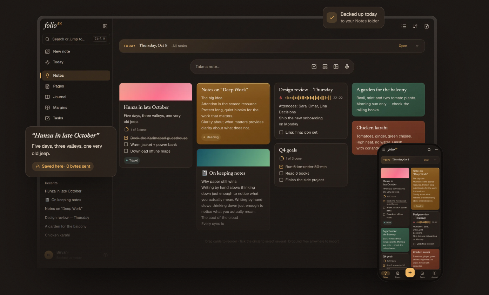

# Folio56

**Private, offline notes. Google Keep outside, Notion inside.**

No accounts. No server. No cloud database. Your notes live in your browser (IndexedDB), and once loaded, the app works fully offline.

**[Try it →](https://folio56-blush.vercel.app)** · Installable as an app on laptop, tablet and phone

<!-- Replace with a screenshot or short GIF of the board + an open page -->


## Highlights

- **Keep-style board, Notion-style pages.** Quick cards with checklists you tick right on the card, plus a full block editor (slash menu, tables, toggles, code, images), pages inside pages, and notebooks.
- **Sync your own devices: no account, no server.** Two devices connect directly over your Wi-Fi (WebRTC, local network only, no STUN/TURN). Only changes travel, and if both sides edited a note, both versions are kept. No shared Wi-Fi? Sync with QR codes instead.
- **Folio Beam: share by QR, screen to camera.** Short notes fit in one code. Bigger ones play as a loop of codes built with a fountain code, so the receiver can start at any moment and still miss codes.
- **Share links that carry the notes.** Notes are compressed inside the link after the `#`, which browsers never send to the server. You can also encrypt a link with a code (AES-GCM).
- **Tasks from every checkbox.** Today, Upcoming and Anytime lists, plus quick add that understands plain words ("send quote fri !!").
- **Optional AI with your own Groq key.** Voice memos become meeting minutes, notes become presentations (export to .pptx or PDF), and RAV (Reason · Attack · Validate) stress-tests an idea.
- **And more:** locked notes (AES-256, on device), version history, 26 templates, export to Word, PDF, Markdown and HTML, and Markdown import (Obsidian, Claude and ChatGPT exports, folders).
- **Calm by design.** Dark and light themes, wallpapers, and a motion system that respects your device's reduce-motion setting.

## What leaves your device

**By default: nothing.** Vercel only serves the app's static files.

- **Share links and Beam:** the notes travel inside the link or the QR codes, and you choose who gets them.
- **Device sync:** goes directly between your devices on your local network.
- **AI features:** off until you add your own Groq API key. After that, only the audio or text you ask to process goes to Groq. If your browser blocks direct calls, a tiny relay (`api/groq.js`) on *your own* deployment forwards the request and never stores it. The key stays on your device and is never included in backups or share links.
- Fonts are bundled and wallpapers are drawn locally, so no third-party requests.

**Honest caveat:** because notes live in the browser, clearing site data deletes them. Export a backup regularly (Settings). Folio reminds you, and on Chrome/Edge it can back up daily to a folder.

## Run locally

```bash
npm install
npm run dev        # http://localhost:5173
npm run build      # production build in dist/
```

## Deploy your own (Vercel free plan)

1. Fork this repo.
2. On vercel.com, choose Add New → Project and import your fork. Vercel detects Vite automatically.
3. Open your URL and install it (Chrome/Edge → Install app, or Add to Home Screen on phones).

Notes are stored per web address, so a new URL starts empty. Export a backup before you move.

## Tests

```bash
npm run preview
npm run qa               # browser checks: laptop, tablet, phone, offline, accessibility
node tests/v64.cjs       # sync: two simulated devices, Wi-Fi and code-only, conflicts
```

## Stack

React · TypeScript · Vite · Dexie (IndexedDB) · BlockNote · Shiki · installable PWA

## Code map

- `src/App.tsx`: layout, views, top bar
- `src/components/`: UI (editor, cards, sidebar, dialogs)
- `src/lib/db.ts`: IndexedDB schema, note actions, export/import
- `src/lib/sync.ts`, `src/lib/syncLink.ts`: device sync
- `src/lib/beam.ts`: Folio Beam (QR fountain codes)
- `src/lib/parcel.ts`: share-link format
- `api/groq.js`: optional AI relay

## Changelog

See [CHANGELOG.md](CHANGELOG.md).

## Feedback

Issues and Discussions are open. The most useful feedback right now:
- Would you trust this with your notes? What would stop you?
- What broke or felt confusing on your device?

## License

MIT. See [LICENSE](LICENSE).
