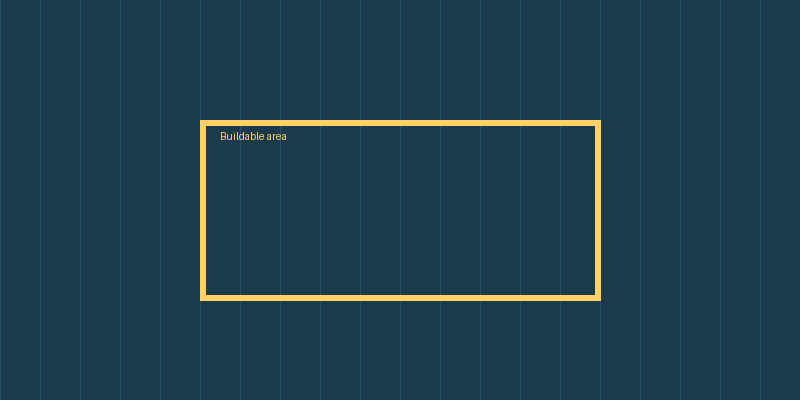

# Solar Siting Checklist

A quick **reference** for evaluating a *utility-scale* site. See [docs](https://example.com).

## 1. Constraints

| Constraint | Typical value | Notes |
|---|---|---|
| Slope | < 10% | East-west can go higher |
| Wetland setback | 100 ft | Check state rules |

## 2. Tasks

- [ ] Pull parcel data
- [x] Run slope analysis
- [ ] Review interconnection queue

### Nested list

1. First step
   - sub point A
   - sub point B
2. Second step

> [!NOTE]
> Setbacks vary by county. Always confirm locally.

> Plain quote here.

```python
def buildable_area(parcel, setbacks):
    return parcel.area - sum(s.area for s in setbacks)
```

---

Inline `code`, ~~strike~~, and a [[Wiki Link]].


